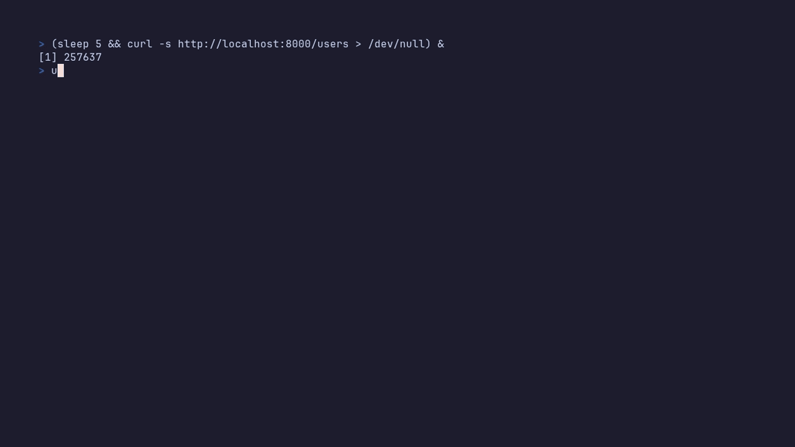

# Easy-Gateway



[](https://github.com/MarkLevkovich/easy_gateway/actions)

### Features (MVP)

- YAML-based configuration, zero code changes for routing
- Prefix & exact path routing
- Redis-backed per-route caching with automatic invalidation on mutations
- Built-in middleware: rate limiting, request logging
- CORS support
- Simple admin panel with Basic Auth
- CLI tool: `easy-gateway`

### Quick Start

```bash
pip install easy-gateway
```

Create a minimal `gateway.yaml`:

```yaml
server:
  host: "0.0.0.0"
  port: 8000

routes:
  - path: "/api/*"
    target: "https://httpbin.org"

middlewares:
  - name: "LoggingMiddleware"
    enabled: true
```

Start the gateway:

```bash
easy-gateway -c gateway.yaml
```

Requests to `http://localhost:8000/api/anything` are now proxied to `https://httpbin.org/anything`.

### Run with Docker

Build the image and run the gateway:

```bash
docker build -t easy-gateway .
docker run -p 8000:8000 \
  -e CONFIG_PATH=example_config.yaml \
  easy-gateway
```

The config path is controlled by the `CONFIG_PATH` env var (defaults to `/easy-gateway/easy_conf.yaml`). If the file is missing, the gateway reports it on startup.

### Documentation

Full configuration reference, caching details, admin panel usage, and production examples are in the **[Wiki](https://github.com/MarkLevkovich/easy_gateway/wiki)**.

### Requirements

- Python 3.12+
- Redis (optional, only required for caching)

### Contributing

This project is in early development. Issues, suggestions, and pull requests are welcome.

### License

MIT
